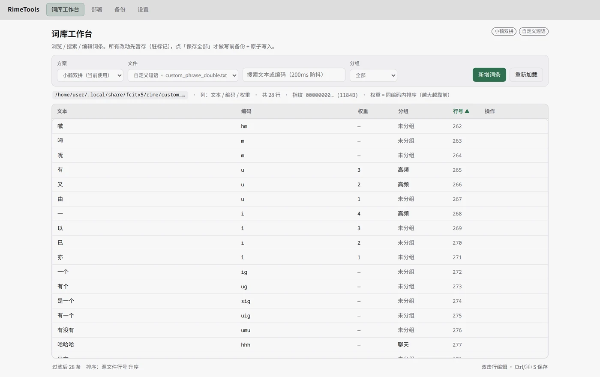
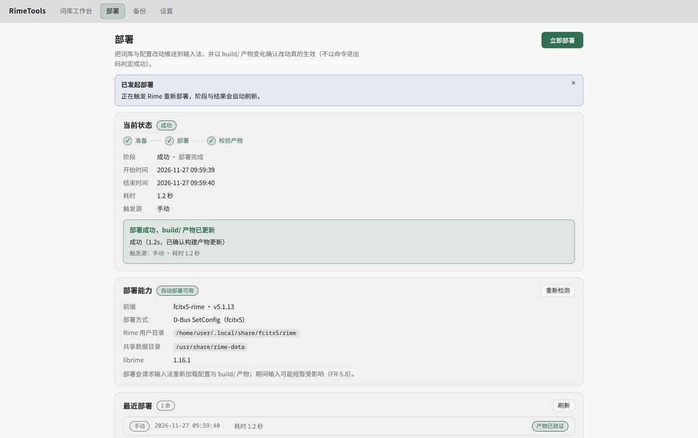
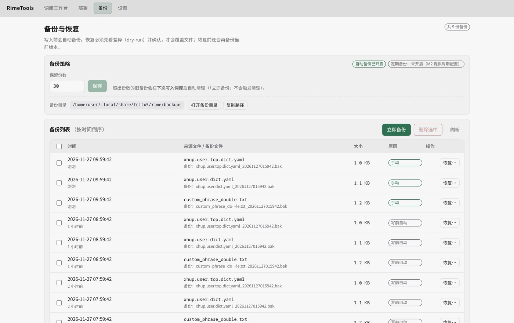

# RimeTools

[](https://github.com/yuc-Li/RimeTools/actions/workflows/ci.yml)

跨平台的 Rime 个人词库管理工具，面向 **Linux（fcitx5-rime）** 与 **Windows（小狼毫 Weasel）**。

Rime 的配置和词库都是可读的文本文件，灵活但日常维护麻烦：加个词、调个权重、改完还得手动重新部署。
RimeTools 把这些高频操作做成图形界面，并保证改写时**不破坏你现有的文件**。

当前版本 **0.1.0**，变更记录见 [CHANGELOG.md](CHANGELOG.md)。



## 功能

**词库工作台** —— 浏览、搜索、排序、分组、批量编辑词条；支持 10 万条词库的虚拟滚动列表。
双击即可修改文本/编码/权重，改动先暂存，确认后一次性写入。

**编码建议** —— 新增词条时按当前方案自动给码，支持三种方案类型：

| 方案类型 | 建议规则 |
| --- | --- |
| 全拼 / 双拼 | 按方案自身的键位规则给出双拼编码，另给简拼 |
| 音形（如小鹤音形） | 二字词拼接、三字词取首键、四字以上取前三字 + 末字首键 |
| 英文 | 小写 / 大写 / 原样，短语自动去空格与连字符 |

多音字会给多个候选；建议只是默认值，随时可改，且**不会自动改写已有编码**。

**一键部署** —— 改完词直接推到输入法，不用再手动「重新部署」。



部署过程会实时显示阶段与耗时，失败时说明原因，并保留历史记录与日志。

**备份与恢复** —— 每次写入前自动备份；恢复时必须先看 diff（新增/删除/修改条数）再确认，
恢复前还会再备份一次当前版本，所以恢复本身也能回滚。



**环境自适应** —— 自动识别输入法前端、用户目录与方案，并推断「这个方案的个人词条存在哪个文件」：

| 方案 | 受管文件 | 格式 |
| --- | --- | --- |
| 小鹤双拼 | `custom_phrase_double.txt` | 文本 / 编码 / 权重（三列） |
| 小鹤音形 | `xhup.user*.dict.yaml` | 文本 / 编码（两列，无权重） |

不硬编码方案名：新增方案只要结构符合，就能被识别。

## 安装

Linux 从 Release 下载：

```bash
# Debian / Ubuntu
sudo dpkg -i rimetools_<版本>_amd64.deb

# 或便携版（装到 ~/.local，无需 root）
tar -xzf rimetools-<版本>-amd64.tar.gz
cd rimetools-<版本>-amd64 && ./install.sh
```

Windows 版尚未打包（代码已有平台适配层，暂未实测）。

## 从源码运行

依赖：Rust 1.77+、Node.js 20+、`libwebkit2gtk-4.1-dev`、`libgtk-3-dev`、`librime-dev`。

```bash
# 开发模式（前端热更新）
./scripts/dev.sh

# 独立模式（前端资源打进二进制，启动快）
./scripts/dev.sh --prod

# 打包 deb + 便携包 → dist-pkg/
./scripts/package.sh
```

## 测试

```bash
cd src-tauri
cargo test --workspace     # 269 个测试
```

前端：`npx tsc --noEmit && npx vitest run`

## 数据安全

- **只动自己的文件**：系统词典与方案原文件不会被修改
- **不覆盖外部改动**：保存前发现文件已被别处改过，会提示重新加载
- **写前必备份**：每次保存前自动备份一份
- **恢复可回滚**：恢复前先看差异，确认后覆盖，且覆盖前再备份当前版本
- **保持原格式**：没编辑的行原样保留，注释与文件格式不变

功能与设计细节见 [docs/PRD.md](docs/PRD.md)。

## 项目结构

```
src/                      Web UI（React + TypeScript）
  ipc/                    接口契约类型与调用封装
src-tauri/
  src/                    应用壳：窗口 / 托盘 / 单实例 / 命令注册
  crates/
    rime-core             词库解析与序列化、查询索引、校验
    rime-suggest          编码建议：双拼映射、音形词码、英文
    rime-safety           写入安全：原子写、备份、外部修改检测
    rime-platform         环境探测与方案识别（唯一允许平台分支的地方）
    rime-deploy           部署编排：fcitx5 D-Bus / 产物新鲜度判定
    rime-ffi              librime 动态加载与隔离会话
tests/fixtures/           测试夹具（合成数据）
scripts/                  启动、打包、图标生成、截图
```

## 许可

本项目的**代码**采用 [MIT](LICENSE) 许可。

工具只在**运行时**解析你本地的 Rime 方案与码表文件，二进制**不包含**任何第三方码表内容。

### 关于测试夹具

`tests/fixtures/` 下保留了少量上游方案文件（rime-ice、rime-crane 的方案与码表片段），
用于测试解析器与编码建议。这些文件**各自遵循原仓库许可**（多为 GPL-3.0），
版权归原作者，本项目不改变也不替代其许可条款。

它们**只用于测试**，不进入发布产物。如果你要在完全 MIT 的环境中使用本项目，
删除 `tests/fixtures/` 即可——依赖夹具的测试会失败而非静默通过。

逐个文件的来源与许可见 [tests/fixtures/NOTICE.md](tests/fixtures/NOTICE.md)。

### 关于"小鹤"相关名称

小鹤双拼、小鹤音形及对应键位规则属于其官方；本工具只是**读取**用户本地已安装的方案，
名称仅用于说明兼容性，不代表任何关联或背书。
